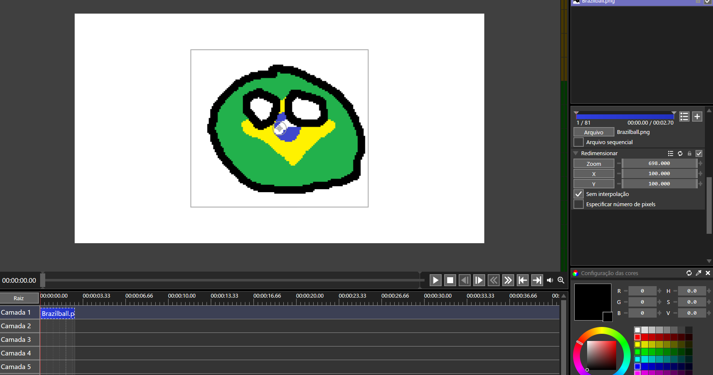

# AviUtl-ExEdit2 - Brazilian Portuguese/Português do Brasil
*English:* This is a Brazilian Portuguese translation for [AviUtl ExEdit2](https://spring-fragrance.mints.ne.jp/aviutl/).

*Português do Brasil:* Essa é uma tradução em Português do Brasil para [AviUtl ExEdit2](https://spring-fragrance.mints.ne.jp/aviutl/).

